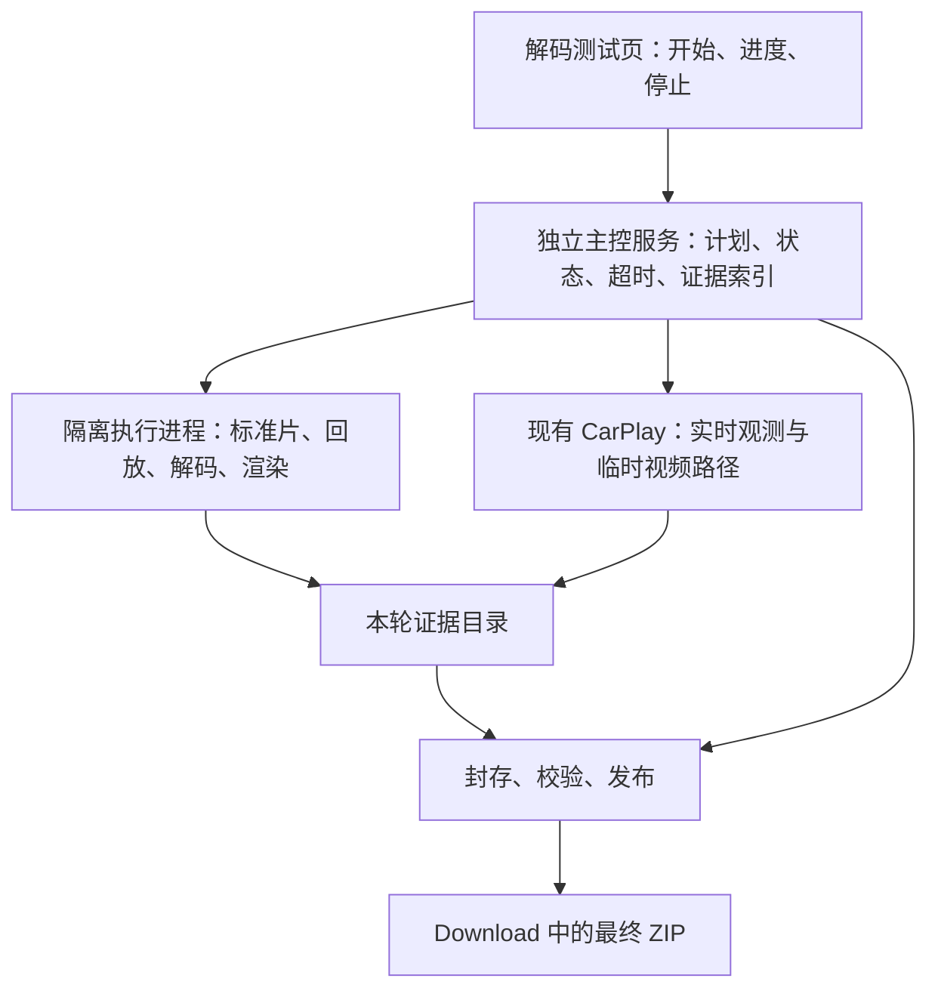

# DiPlay 解码自动化测试与信息采集系统设计方案

日期：2026-10-26
状态：用户已确认实施；系统改造已落地，目标车机与连接 iPhone 的验收尚未完成（2026-10-27）。
适用目标：吉利星瑞 2026 款昆仑，Flyme Auto，Android 9／API 28。
范围：本文件作为目标与验收基准；用户已另行授权改造。版本升级、提交代码仍按用户明确指令执行。

目标是建立一套以诊断问题为中心、有固定证据标准、能独立收尾的测试系统。用户停车、连接好 iPhone，点一次开始；软件完成测试、恢复原配置，把本轮可用于分析的证据放进一个 ZIP。某项不支持或失败，也必须说明原因并完成收尾。

## 1．必须回答的诊断问题

| 诊断问题 | 必须拿到的证据 |
|---|---|
| 为什么颜色发白，尤其浅色模式背景与图标底色合并？ | 深浅模式来源和实际生效状态；近白灰阶的输入／输出对应值；全／有限范围解释；同源不同路径结果与实际输出配置 |
| 为什么静态画面模糊？ | 原始接收视频短样本、参考解码画面、原尺寸输出截图、完整缩放与裁剪信息 |
| 为什么软件直出不跟手？ | 稳定运动负载下的逐帧时序、队列深度、各阶段耗时及负载变化 |
| 哪条路径最适合这台车机？ | 输入和条件一致的路径对照、实际生效情况、复测结果 |
| 测试本身是否可靠？ | 每项执行状态、证据完整性、异常记录、资源释放结果、最终文件校验 |

每条诊断结论都必须能指向具体证据。“跑完多少项”只表示执行进度，不代表问题已经定位，更不代表画质通过。

### 1.1 本轮优先假设：浅色模式的高光灰阶裁剪

用户补充现象：CarPlay 深色模式观感正常；浅色模式下背景与图标底色难以区分，类似曝光过度。此前已确认 DiPlay 自身设置页正常，其他安卓手机投屏正常。

现有车机标准片日志中，全范围样本有以下对应关系：

| 输入参考灰度 | 全范围样本捕获结果 |
|---|---|
| 192 | 205 |
| 208 | 224 左右 |
| 224 | 242 |
| 232 | 251 左右 |
| 240、248、252、255 | 均成为 255，即纯白 |

有限范围样本基本保留这些灰阶。该形态高度符合全范围数据被按有限范围再次拉伸后产生的高光裁剪，应列为首要验证假设 H1，而不是直接认定为根因。标准片的软件直出也出现过同类裁剪，因此不能直接归咎于 MTK 硬解，也不能凭软件直出的观感更好判定范围处理完全正确。

证据来源：2026-10-25 实车日志目录 diplay-log 中最新 video-adaptation ZIP 的 report.json，separateColorTestHistory 最近的 H264 全／有限范围、纹理／直接、默认／软件样本；输入参考见项目 color-test/manifest.json。上述为旧标准片证据，不等于已经量化证明新反馈中每个真实 CarPlay 页面都发生相同转换。

深色模式观感正常不作为颜色链路通过标准；浅色内容更容易暴露近白灰阶合并。需要检查两种模式的源颜色声明、实际输出和采样条件，不能假设切换主题后只有像素内容变化。


## 2．三层测试

| 测试层 | 输入 | 作用 |
|---|---|---|
| 标准输入测试 | 软件内置、已知内容和编码参数的诊断片 | 排除 iPhone、无线传输和画面内容变化，比较车机解码与显示路径 |
| 同源回放测试 | 本轮从 iPhone 收到的同一份完整视频片段 | 检验真实 CarPlay 码流在不同路径上的差异 |
| 实时主屏核验 | 正常运行中的 CarPlay | 检查协商、接收、生产渲染、生命周期和恢复是否正常 |

三层结果分别保存。标准片播放流畅，不能直接写成“真实 CarPlay 滑动流畅”；实时主屏静止了 20 秒，也不能算完成了运动测试。

## 3．控制、执行与报告收尾独立



- 页面只负责展示，关闭页面不取消已经开始的采集和报告任务。
- 主控服务不直接执行可能卡住的解码器、GPU、下载服务调用。
- 标准片和回放放在可回收的诊断执行进程中，复用生产解码、渲染组件。
- 正常 CarPlay 保留现有协议和音频链路，只提供视频诊断接口。
- 解码执行失败后，主控仍能保存已获得的证据。
- 发布文件与登记系统下载列表分开。下载服务登记失败，不能拖住已经成功写入的报告。

需要建立统一的视频诊断接口，不能继续依靠页面跳转、多个零散导出方法串联流程。

## 4．开始前的能力与交付预检查

| 检查内容 | 不满足时的处理 |
|---|---|
| 下载权限和公共目录实际可写性 | 明确提示；不能假设“权限已授予”等于文件可写 |
| 内部工作目录、剩余空间 | 不足以保留关键证据时，结束预检查并说明所需空间 |
| 当前是否已有测试或未释放的解码资源 | 拒绝重叠启动 |
| iPhone、CarPlay 会话状态 | 标明实时测试条件是否具备 |
| 屏幕、窗口和视频协商尺寸 | 建立本轮对照基线 |
| 原始视频设置和实际运行模式 | 保存恢复快照 |
| 软件版本、诊断计划版本、测试素材校验值 | 确保回来后知道具体运行的是哪个包 |

公共目录预检查必须实际创建、写入、读回并校验一个本轮临时文件，而不是只调用权限检查。

首次系统授权属于运行前置条件；进入正式测试后，不再反复弹窗要求用户操作。

## 5．软硬件信息的采集模型

按静态、动态、事件三类采集。

| 类别 | 主要内容 | 采集方式 |
|---|---|---|
| 系统与应用 | Android/API、固件、内核、ABI、应用版本、APK 指纹、UID、权限、诊断配置 | 开始时一次 |
| CPU、内存、存储 | 可读的 CPU 信息、在线核心、频率接口、内存、容量、可用空间 | 基础快照＋负载阶段采样 |
| GPU 与显示 | GPU/驱动、图形能力、物理与逻辑像素、刷新率、旋转、窗口、Surface、裁剪、变换 | 开始时＋变化事件 |
| 解码能力 | 实际解码器、格式、Profile/Level、颜色格式、尺寸/帧率声明、必要能力探针 | 每种能力一次 |
| 网络与连接 | 连接类型、协商参数、接收速率、间隔、异常与断线 | 持续统计＋事件 |
| 运行负载 | 应用 CPU、线程负载、内存、可读频率与温度原始值 | 测量前、中、后 |
| 外设 | USB 描述符、权限和连接状态 | 只读枚举，不抢占设备 |

每个字段统一保存：值、单位、来源、时间、可读状态、可信程度和失败原因。

不能读取的字段写明原因；未经验证的热区不标成 CPU 温度；单次频率、单次电池温度不能作为“性能不足”或“发生降频”的结论。

## 6．完整的核心路径对照矩阵

必须先跑齐四组，分离解码器和输出方式的影响。

| 路径 | 解码 | 输出 |
|---|---|---|
| P1 | 硬件解码 | TextureView |
| P2 | 硬件解码 | SurfaceView 直接输出 |
| P3 | 软件解码 | TextureView |
| P4 | 软件解码 | SurfaceView 直接输出 |

然后加入：

| 路径 | 目的 |
|---|---|
| P5：软件解码＋应用 YUV 转换 | 检查应用控制颜色后的效果与复制、绘制成本 |
| P6：硬件解码＋应用 YUV 转换 | 验证能否兼顾硬解性能和正确颜色 |

每项同时记录请求路径和实际路径。P6 失败后退回 P2，只能记录“P6 不可用，已回退 P2”，不能算 P6 测试成功。

同组对照固定：

- 相同输入文件或接收样本。
- 相同编码、尺寸、供帧节奏。
- 相同窗口、Surface 和裁剪条件。
- 相同画面调整参数；同组路径对比固定深浅模式，不把主题变化与解码或输出切换混在一起。
- 独立的预热、测量和截图阶段。

测试中出现尺寸、配置或会话变化，该组数据不能继续混合比较。

深浅模式作为单独维度组织，至少先在同一路径上完成浅／深对照，再分别完成路径对照。必须区分 iPhone／CarPlay 界面模式与 DiPlay 应用主题，记录请求状态、实际观察状态及验证依据。只有实际生效可确认时，才标为浅色或深色样本。

不能保证自动控制真实 CarPlay 主题时，不假装已经自动切换，也不反复要求用户手动切换。标准诊断片自动覆盖浅／深内容；实时模式未获得的一侧明确列为证据缺口。


## 7．标准输入与测量窗口

| 素材 | 测试内容 |
|---|---|
| 色块、灰阶 | 全／有限范围、BT.601／BT.709、近黑、近白、灰阶合并、颜色偏差；优先测量浅色内容的高光裁剪 |
| 浅色／深色成对内容 | 使用固定图案、几何与画面调整条件，检查浅背景、图标底板、边框和文字区分度，区分“深色不明显”与“链路正确” |
| 静态清晰度 | 1、2、4、8 像素线条、棋盘格、文字、斜边和裁剪边界 |
| 稳定运动 | 30fps、60fps 的受控运动，测量吞吐、积压与耗时 |
| 手机实际颜色声明对应样本 | 检查真实 CarPlay 使用的特殊参数组合 |

素材必须附带编码参数、源文件校验值和独立参考结果。期望值不能由待测的同一段颜色转换代码计算，避免自己验证自己。

近白测试必须覆盖 224–255 的密集灰阶，并在 232–240 区域增加取样，检查有限范围亮端边界附近是否出现异常截断；近黑区域同步检查，防止只关注高光而遗漏黑位压缩。独立参考以实际编码文件的参考解码结果为准，不把理想 RGB 灰度直接当作有损编码后必然相等的像素。

全／有限范围对照保持编码、矩阵、传递特性、尺寸和图案一致，只改变目标范围维度。手机实际声明不同于标准组合时，另建同源组，不混入标准组平均。


性能测试先预热，再进入稳定测量窗口。截图、压缩图片、打包、完整硬件枚举都放在测量窗口之外。

测试数量由能力和计划生成，不再写死成“39 项就是全面”。

## 8．可离线复现的真实输入证据

从接收端保存一小段完整、可解码、有明确边界的 CarPlay 视频样本，包括：

- 编码格式与完整配置。
- 从关键帧开始的连续压缩数据。
- 每个访问单元的索引、长度、原始时间戳。
- 捕获期间的网络异常、丢失或恢复记录。
- 对应的会话、尺寸、颜色声明和输入样本校验值。
- 浅／深模式请求、实际状态及确认依据；在获得两种实际样本时分别保存，缺少的一侧明确标记。


不保存整场投屏录像。建议默认每段限制在约 10 秒、8 MiB 内，实际按完整关键帧组和总数据预算控制。

随后用这份样本在核心路径上回放。收到 ZIP 后，可以离线判断输入是否本来就不清晰、颜色声明是什么、是否存在重排，以及不同车机输出为何产生差异。

捕获不完整的样本必须标记不可用于严格回放比较，不能当作正常输入。

## 9．逐帧关联的延迟测量

| 边界 | 能分析的内容 |
|---|---|
| 接收、组装完成 | 接收间隔、突发到达 |
| 进入应用队列、取出 | 应用积压 |
| 准备输入、取得输入缓冲、提交解码器 | 输入等待与准备成本 |
| 取出解码输出 | 解码器内部处理、缓存和重排相关耗时 |
| YUV 复制、上传、绘制提交 | 应用颜色路径成本 |
| Surface 提交及可用的渲染回调 | 输出等待相关证据 |

每帧通过同一组标识关联，保存队列深度、异常、恢复和丢弃原因。输出均值、P50、P95、P99、最大值及随时间的变化。

测量边界必须明确：

- 提交解码器到取出结果包含内部缓存，不能全部算成 CPU 解码时间。
- 提交到 Surface 不等于物理屏幕已经显示。
- 手机与车机时钟映射不可靠时，不计算单向传输延迟。
- 没有可识别的触摸响应，就不宣称测到了完整触摸延迟。

## 10．颜色、清晰度的取样与解释

按以下链路组织证据：

接收码流 → 解码结果 → 应用颜色转换 → 输出／合成截图 → 物理屏幕。

每张图注明：

- 输入样本、帧或静态区间。
- 解码器与配置。
- 截图方法。
- 图像、预览、缓冲区尺寸。
- 裁剪、旋转、缩放和画面调整。
- 是否确认原尺寸取样。

颜色输出色块误差、灰阶分离和裁剪数据；清晰度输出条纹对比度、边缘和几何数据。阈值必须经过已知输入校准并有版本，未经校准的差异只标疑点。

对 H1 单独输出：各近白色块的参考值与实测均值、相邻色块亮度差、合并组、饱和到白色的比例，以及深浅内容中的局部对比度。跨色块判为合并必须使用校准容差，不能用单个像素或未经校准的亮度公式下结论。

分别计算与正确范围转换、重复有限范围扩展假设的符合程度。符合某个数值形态只提升该假设的优先级，不能代替定位具体责任层。补齐原始短码流、参考解码结果与对应输出截图后，再判断差异出现于输入、解码输出、颜色转换、合成还是截图不可见的显示后处理。

不把全局降低亮度、饱和度或对比度作为裁剪已修复的证据；被截成相同白色的细节不能靠整体调暗证明恢复。


对可控片段，采用帧标识或稳定画面捕获，保证比较的是同一内容。不能确认同帧、原尺寸或取样位置时，降低证据等级。

截图无法测量最终面板颜色、背光和所有车机后处理。如果应用输出正常而肉眼仍发白，报告应明确把问题留在这一边界之外。

## 11．真实 CarPlay 的生产链路核验

实时核验检查：

- 实际协商与收到的视频是否一致。
- 生产主屏是否使用预期路径。
- 接收、解码、输出是否持续稳定。
- 是否发生回退、重配、断线。
- 实际浅／深模式与近白背景、图标底板是否具备可比较的取样；深色正常不能替代浅色验证。
- 测试结束后原投屏是否恢复。

主屏确实发生运动时，才记录为动态运行证据；静态页面只算静态证据。

默认不在地图、电话或其他真实 CarPlay 界面中自动点击、拖动。解码负载由标准运动片与同源回放提供，不能用它冒充完整的 iPhone 交互响应测试。

## 12．统一状态机、超时与恢复

执行顺序固定为：

预检查 → 基础采集 → 能力探针 → 标准测试 → 同源回放 → 实时核验 → 必要复测 → 恢复原状态 → 封存 → 发布。

每项单独保存四种状态：

| 状态维度 | 示例 |
|---|---|
| 执行状态 | 完成、不支持、失败、超时、取消、未执行 |
| 测量有效性 | 有效、输入不足、配置变化、截图缩放、负载不一致 |
| 证据完整性 | 完整、缺帧、缺截图、缺传感器、样本不可回放 |
| 发布状态 | 内部已封存、公共目录已验证、仅内部副本、发布失败 |

执行结束、测量有效、画质通过、文件已交付必须分开，不能混成一个成功。

以下为设计初值，最终要通过真实 Android 9 执行验证：

| 操作 | 上限／处理 |
|---|---|
| 可选信息探针 | 单项限制；分组最多约 30 秒，失败保留其他信息 |
| 解码初始化、首帧 | 各约 5 秒，不支持后跳过关联用例 |
| 截图 | 最多约 5 秒，超时标缺失 |
| 释放资源 | 正常等待后进行一次受控恢复；仍不能确认则停止后续视频测试 |
| 连接恢复 | 有限次数和预算，不循环重连 |
| 报告打包、公共写入 | 分别设超时，保留源数据 |
| 下载列表登记 | 独立、可放弃，不阻塞文件交付 |
| 整套测试 | 默认目标约 8–12 分钟，总预算约 15 分钟 |

遇到严重驱动故障，允许停止视频测试，继续封存已有证据。不能为了全跑完而强行叠加解码器。

## 13．证据标识、目录与结果包

核心关联关系：

运行 → 测试项 → 输入样本 → 视频会话／解码实例 → 帧 → 截图／日志。

同时保存计划版本、APK 指纹、素材校验值、原始配置和时间基准。

使用稳定的测试项名称，避免依赖列表下标。历史测试作为独立参考，不能混入本轮有效结果；当前运行的文件不能被历史清理误删。

最终 ZIP 建议包含：

```text
summary.txt                 人能读懂的结果与缺口
run.json                    版本、计划、环境、时间、终止原因
device/                     软硬件、能力、动态负载
cases/                      各项配置、结果与有效性
inputs/                     真实短码流及访问单元索引
captures/                   对应截图和取样说明
traces/                     逐帧时序、队列、连接及异常
reference/                  标准素材参数与参考说明
unexecuted.json             未执行项与原因
manifest.json               文件大小、SHA256、缺失清单
```

默认设置数据预算，例如 256 MiB。空间预算必须在开始前检查，不能到最后才发现没地方打包。若必须削减材料，要明确标记，不能静默删除关键证据。

## 14．独立的报告发布流程

1. 先在应用工作目录封存本轮证据。
2. 生成 ZIP，关闭文件。
3. 重新读取 ZIP，检查条目、大小和校验值。
4. 写入公共下载目录的临时文件。
5. 关闭、校验，再发布为最终文件。
6. 主控记录实际路径、大小、校验值和时间。
7. 最后独立登记系统下载列表。

只有公共文件校验成功，页面才显示已保存到 Download。

下载列表登记失败，显示文件已写入、下载列表登记失败，不能删除文件。公共目录失败，保留内部包并允许重新导出；内部临时目录不可写，要有替代目录。全部存储都失败时，明确显示发布失败，保留能够保留的原始数据。

包内记录测试事实；发布后的真实收据由主控保存，不能提前把尚未发生的公共写入写成成功。

## 15．诊断摘要与结论规则

摘要应直接列出：

- 哪些路径真正运行，哪些发生回退。
- 哪些对照具备可比性。
- 哪条路径颜色数值、细节保留和稳定延迟表现更好。
- 每条判断引用哪些测试项、帧和截图。
- 当前能支持或排除哪些原因。
- H1 的支持／反证、近白灰阶合并情况，以及真实浅／深样本是否齐备。
- 哪些仍缺证据。
- 原设置和投屏是否恢复。
- 最终报告是否真正交付。

结论遵循证据强弱：

| 观察结果 | 优先分析方向 |
|---|---|
| 浅色近白灰阶合并，且全范围样本接近再次有限范围扩展的数值形态 | 优先验证色彩范围解释与高光裁剪 H1；具体责任层仍需同源证据 |
| 深色观感正常、浅色证据缺失 | 颜色结论不完整，不能标为通过 |
| 接收样本参考解码已经模糊 | 输入编码、源内容与协商 |
| 同源硬解直接清晰，硬解纹理变软 | 纹理、缩放、合成相关路径 |
| 入解码器前队列持续增长 | 应用调度或输入突发 |
| 解码器内部持续保留多帧 | 缓存、重排及解码输出策略 |
| 解码快，复制或绘制明显慢 | 应用 YUV／GPU 输出成本 |
| 输出截图正常，物理屏幕仍发白 | 最终显示处理或面板边界 |

不根据一次测试自动修改日常默认模式。证据不足时，结论就是不足以判断，同时说明缺少的证据。

## 16．测试系统自身的交付验收

验收分三层：

- 逻辑与故障注入：不返回、晚返回、重复回调、进程退出、取消、权限撤回、目录不可写、磁盘不足、报告损坏、配置变化。
- 颜色证据专项回归：正确范围转换、重复有限范围扩展、近白灰阶合并、近黑裁剪、深色观感正常但浅色失败、主题请求未实际生效，以及缺少真实主题样本。必须能区分数字裁剪证据与主观曝光感，不误报 MTK 单独故障。

- 真实 Android 9 执行：实际解码、绘制、截图、文件发布与完整收尾；模拟框架通过不能替代这一层。
- 目标车机验收：验证 MTK 驱动、车机显示链路、连接恢复与实际文件可取出。

验收标准：

正常情况得到可分析的完整包；受限情况得到明确标识的部分包；异常情况有终止原因和已有证据；任何状态都不伪装成全部通过。

系统杀进程、断电或整个存储系统失效，不能承诺继续后台运行。设计应通过持久日志，在下次打开时封存未完成结果、允许重新导出，避免为了取包重新测试。

系统改造与验证结果见 [实施验证记录](../plans/2026-10-27-decoder-diagnostics-system-validation.md)。模拟器已验证执行、部分收尾与真实文件交付；目标车机、真实 iPhone 与颜色阈值校准仍需各自证据，不能标成全部验收通过。
